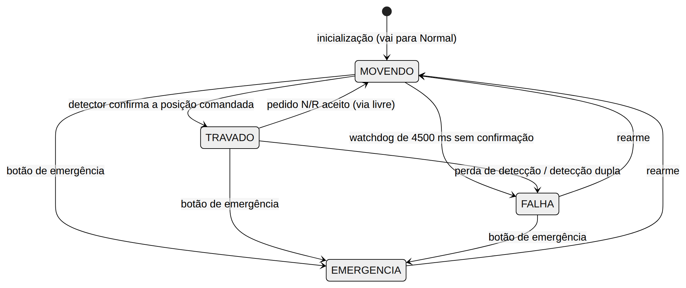
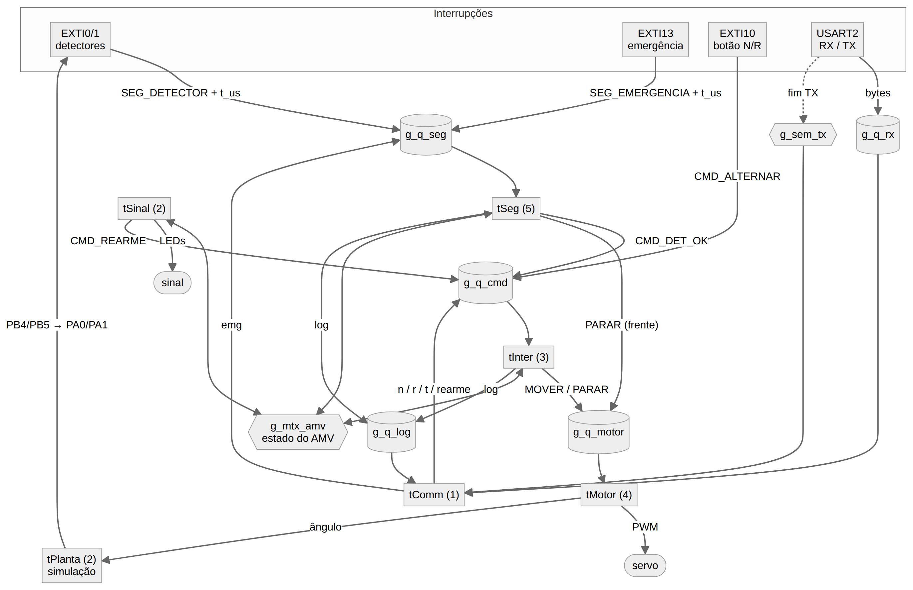
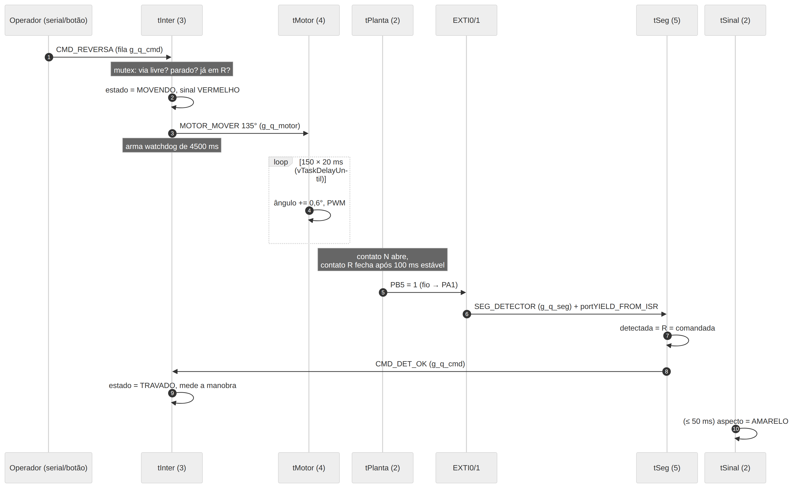
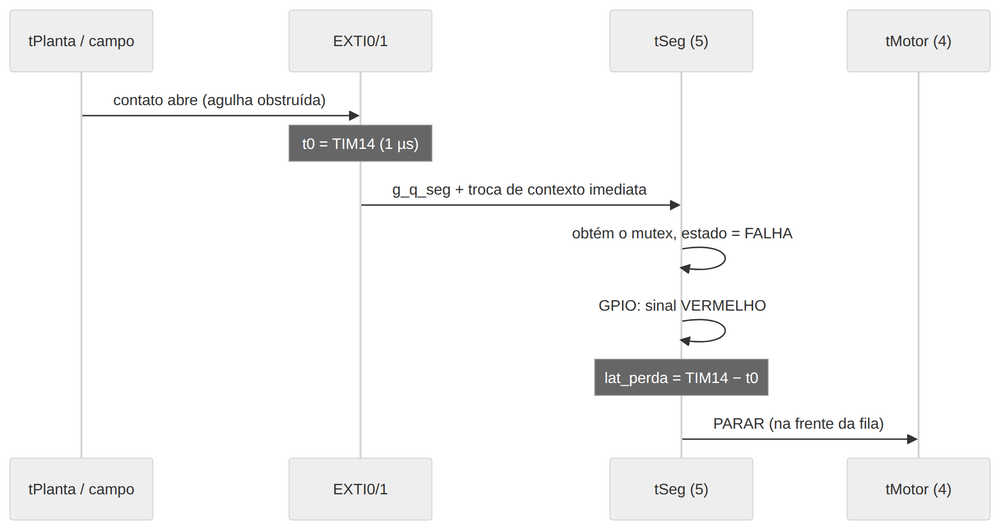

# Texto inserido em Tópicos2.docx (capítulos 3 e 4)

## 3 PROCESSO A SER MODELADO

O processo modelado neste trabalho é a manobra de um Aparelho de Mudança de Via (AMV), popularmente chamado de desvio ferroviário. O AMV é composto por um par de agulhas móveis que, conforme sua posição, direciona o trem para a via normal (trajeto reto) ou para a via reversa (trajeto desviado). Em sistemas metroferroviários, a movimentação das agulhas é realizada por uma máquina de chave elétrica e supervisionada pelo intertravamento, sistema responsável por garantir que nenhum sinal autorize a circulação por uma rota incompatível com o estado real da via.

O ciclo de operação começa com uma solicitação de mudança de rota emitida pelo Centro de Controle Operacional (CCO). Ao receber o pedido, o sistema verifica se a manobra é permitida, isto é, se o circuito de via sobre o AMV está livre e se não há falha ou emergência pendente. Sendo permitida, o sinal de proteção é imediatamente colocado em vermelho, a máquina de chave é acionada e as agulhas iniciam o deslocamento. Ao final do curso, os detectores de fim de curso indicam a posição efetivamente alcançada. Somente quando a posição detectada coincide com a posição comandada o AMV é considerado travado e o sinal pode ser liberado: verde para a via direta ou amarelo para a via desviada, que exige velocidade reduzida.

Toda a lógica de segurança do sistema decorre de uma regra central, baseada no princípio fail-safe: o sinal só pode exibir um aspecto diferente de vermelho se, e somente se, o AMV estiver no estado travado e a posição detectada for igual à posição comandada. Qualquer situação de dúvida, como perda de detecção, detecção simultânea das duas posições ou ausência de confirmação dentro do prazo, conduz o sinal ao vermelho. A Tabela 1 resume os pontos críticos identificados no processo, os riscos associados e a forma de tratamento adotada.

**Tabela 1 - Pontos críticos do processo de manobra do AMV**

| Ponto crítico | Risco se não tratado | Tratamento adotado |
|---|---|---|
| Agulha não encosta (obstrução, desgaste) | Descarrilamento na agulha | O detector deve confirmar a posição em até 4,5 s; caso contrário, o sistema entra em falha |
| Agulha abre com o trem já liberado | Descarrilamento | A perda de detecção leva o sinal ao vermelho em microssegundos |
| Movimentação do AMV com trem sobre ele | Descarrilamento ou dano ao equipamento | Com o circuito de via ocupado, o pedido fica em espera e só é executado quando a via é liberada |
| Sinal aberto antes do travamento | Trem conduzido para a rota errada | O sinal só sai do vermelho no estado travado e com detecção igual ao comando |
| Situação de emergência | Colisão | O botão de emergência leva todo o sistema ao estado seguro; o retorno exige rearme explícito |

*Fonte - Próprio Autor (2026).*

O comportamento do intertravamento foi modelado como uma máquina de estados com quatro estados: MOVENDO, TRAVADO, FALHA e EMERGÊNCIA. Na inicialização, o sistema não conhece a posição das agulhas e, por isso, entra em MOVENDO com destino à posição normal. A partir de MOVENDO, a confirmação do detector leva ao estado TRAVADO, enquanto o estouro do temporizador de supervisão (watchdog) sem confirmação leva ao estado FALHA. Em TRAVADO, um novo pedido aceito reinicia a manobra, e a perda ou duplicidade de detecção leva à FALHA. O botão de emergência leva qualquer estado à EMERGÊNCIA. Os estados FALHA e EMERGÊNCIA são bloqueantes: rejeitam novos pedidos e só são abandonados por meio de um comando de rearme, que refaz a manobra para a última posição comandada. A Figura 2 ilustra essa máquina de estados, e a Tabela 2 detalha as transições previstas.

**Figura 2 - Máquina de estados do intertravamento**

*Fonte - Próprio Autor (2026).*

**Tabela 2 - Transições da máquina de estados do intertravamento**

| Estado atual | Evento | Próximo estado |
|---|---|---|
| (inicialização) | Energização do sistema | MOVENDO (para Normal) |
| MOVENDO | Detector confirma a posição comandada | TRAVADO |
| MOVENDO | Watchdog de 4.500 ms sem confirmação | FALHA |
| TRAVADO | Pedido de mudança aceito (via livre) | MOVENDO |
| TRAVADO | Perda de detecção ou detecção dupla | FALHA |
| MOVENDO, TRAVADO ou FALHA | Botão de emergência | EMERGÊNCIA |
| FALHA ou EMERGÊNCIA | Rearme | MOVENDO (refaz a manobra) |

*Fonte - Próprio Autor (2026).*

A confirmação de posição foi projetada com dois caminhos independentes. O caminho principal é orientado a eventos: a borda do sinal do detector gera uma interrupção, que é encaminhada à tarefa de segurança. Como redundância, durante a manobra a tarefa de intertravamento também lê o nível dos detectores a cada 50 ms. Assim, mesmo que uma borda seja perdida, a manobra ainda é concluída corretamente, e o evento registrado indica qual dos caminhos realizou a confirmação. Quando o watchdog estoura, o sistema registra um diagnóstico da cadeia motor, planta, fio e pino, indicando o ponto em que a confirmação deixou de ocorrer.

Pedidos recebidos enquanto o circuito de via está ocupado ou o AMV está em movimento não são descartados, mas armazenados como pedido em espera (route stacking). Assim que o AMV estiver travado e o circuito livre, a manobra é executada automaticamente. Prevalece sempre o último pedido recebido, e um pedido para a posição atual cancela a espera, assim como uma falha ou emergência. Esse mecanismo é relevante porque, com o trem circulando, o circuito de via permanece ocupado entre 23 % (a 20 km/h) e 68 % (a 80 km/h) do tempo; sem a espera, a maior parte dos pedidos seria perdida.

Para a modelagem, o escopo foi delimitado a um único AMV e seus elementos de campo associados. Como o trabalho é desenvolvido em ambiente simulado, cada elemento real foi representado por um componente do simulador Wokwi, conforme apresentado na Tabela 3.

**Tabela 3 - Correspondência entre os elementos reais e o modelo simulado**

| Elemento real | Representação no simulador | Pino |
|---|---|---|
| Máquina de chave | Servomotor (45° = Normal, 135° = Reversa) | PA6 (TIM3_CH1, PWM 50 Hz) |
| Detectores de fim de curso N/R | Contatos gerados pela tarefa de planta, ligados por fio a entradas com interrupção | PB4→PA0 e PB5→PA1 (EXTI0/1) |
| Circuito de via (ocupação) | Chave deslizante, comando serial ou trem simulado | PA4 |
| Obstrução da agulha (falha) | Chave deslizante ou comando serial | PB1 |
| Sinal de proteção | LEDs vermelho, amarelo e verde | PB0, PA7 e PB6 |
| Comando do CCO | Botão N/R ou comando serial | PA10 (EXTI10) |
| Botão de emergência | Botão vermelho ou comando serial | PC13 (EXTI13) |
| Rearme | Botão amarelo ou comando serial | PB3 |
| Trem | Tarefa de simulação, exibida no painel web | Ocupa o circuito de via |

*Fonte - Próprio Autor (2026).*

Para exercitar o intertravamento em condições próximas às reais, foi incluído um trem simulado de 30 m que percorre um circuito fechado contendo o AMV, com velocidade ajustável entre 0 e 80 km/h. O trem obedece ao sinal por meio de uma curva de frenagem, semelhante a um sistema de proteção automática de trens (ATP), dada por v_perm = √(v_final² + 2·a·d), com desaceleração de serviço a = 1,2 m/s². Diante do sinal vermelho, o trem para 5 m antes dele; no amarelo, reduz a velocidade para 30 km/h no ramal desviado. Caso o sinal feche quando a frenagem de serviço não for suficiente, é aplicada a frenagem de emergência (2,5 m/s²). Se nem esta for suficiente, o trem ultrapassa o sinal vermelho, e, se chegar ao AMV com as agulhas sem detecção, descarrila. Esses eventos são registrados e permitem avaliar as consequências de uma falha do sistema de controle.

O circuito de via é considerado ocupado desde o sinal até a saída da cauda do trem do AMV e também antes do sinal, quando o trem já não consegue mais parar nele (travamento de aproximação). Esse critério impede que o AMV seja movimentado à frente de um trem que já está comprometido com a rota.

## 3.1 CÁLCULOS E GARANTIAS DE ATUAÇÃO

As garantias temporais do sistema foram definidas a partir das características do processo físico e da plataforma utilizada: microcontrolador STM32C031C6, com núcleo ARM Cortex-M0+ operando a 48 MHz (um ciclo de aproximadamente 20,8 ns), tick do FreeRTOS de 1 ms e controlador de interrupções (NVIC) com 2 bits de prioridade.

#### 3.1.1 Janelas de tempo

A Tabela 4 apresenta as metas temporais estabelecidas para cada caminho de execução e a justificativa de cada valor. Os caminhos de segurança, que conduzem o sinal ao vermelho, têm metas na ordem de milissegundos, pois devem ser praticamente instantâneos na escala de movimento do trem. Já a manobra completa tem meta na ordem de segundos, compatível com as máquinas de chave reais.

**Tabela 4 - Metas temporais por caminho de execução**

| Caminho | Meta | Justificativa |
|---|---|---|
| Emergência → sinal vermelho | ≤ 10 ms | A 80 km/h (22,2 m/s), o trem percorre 0,22 m em 10 ms, distância desprezível frente à visibilidade do sinal |
| Perda de detecção → sinal vermelho | ≤ 10 ms | A restrição deve ser instantânea na escala do trem |
| Pedido → motor comandado | ≤ 50 ms | Imperceptível ao operador; não é caminho de segurança |
| Manobra completa (motor → travado) | Nominal 3.000 ms; limite 4.500 ms | Máquinas de chave reais levam de 3 a 6 s; o watchdog equivale a 1,5 vez o tempo nominal |
| Período do motor | 20 ms ± 1 ms | Corresponde ao período do PWM do servomotor |

*Fonte - Próprio Autor (2026).*

#### 3.1.2 Duração esperada da manobra

O curso da máquina de chave vai de 45° a 135°, totalizando 90° (9.000 centésimos de grau). Para que a manobra dure o tempo nominal de 3.000 ms com passos a cada 20 ms, são necessários 150 passos de 60 centésimos de grau (0,6°). A esse tempo somam-se o fechamento do contato do detector, que exige 100 ms de estabilidade mais até um período da tarefa de planta (10 ms), e o processamento da interrupção e das tarefas de segurança e intertravamento, inferior a 1 ms. Dessa forma, a duração esperada da manobra é de aproximadamente 3.100 a 3.120 ms, o que deixa uma margem de cerca de 1.380 ms (44 %) até o limite do watchdog de 4.500 ms. Na inicialização, o percurso é de 90° a 45°, com 75 passos, resultando em aproximadamente 1.600 ms.

#### 3.1.3 Latência do caminho de segurança

O caminho mais crítico do sistema é o que vai da interrupção do detector, ou do botão de emergência, até o acionamento do sinal vermelho. A Tabela 5 apresenta a estimativa de pior caso, decomposta em suas parcelas, considerando a entrada na interrupção, o envio da mensagem para a fila, a troca de contexto e a execução da tarefa de segurança, além das possíveis interferências.

**Tabela 5 - Estimativa de latência do caminho de segurança (pior caso)**

| Parcela | Ciclos (estimado) | Tempo |
|---|---|---|
| Entrada na ISR (hardware Cortex-M0+) | 16 | 0,3 µs |
| Tratador EXTI da HAL + callback + xQueueSendFromISR | ~400 | ~8 µs |
| Troca de contexto (PendSV) | ~150 | ~3 µs |
| Tarefa de segurança: recebe da fila, obtém o mutex e escreve 3 GPIOs | ~400 | ~8 µs |
| Subtotal sem interferência |  | ≈ 20 µs |
| Bloqueio pelo mutex com a tarefa de sinal (herança de prioridade) | ~300 | ~6 µs |
| Outra ISR de mesma prioridade sendo atendida | ~400 | ~8 µs |
| Seção crítica mais longa do kernel | ~200 | ~4 µs |
| Pior caso estimado |  | ≈ 40 µs |

*Fonte - Próprio Autor (2026).*

O pior caso estimado, de aproximadamente 40 µs, é cerca de 250 vezes menor que a meta de 10 ms. A parada do motor ocorre no próximo passo da tarefa de motor, ou seja, em até 20 ms; contudo, a segurança não depende desse tempo, pois o sinal já se encontra em vermelho.

#### 3.1.4 Análise de escalonabilidade

Para verificar se o conjunto de tarefas é escalonável, foi estimado o tempo de execução no pior caso (C) de cada tarefa e seu período ou intervalo mínimo entre ativações (T), obtendo-se a utilização U = C/T, conforme a Tabela 6.

**Tabela 6 - Utilização da CPU por tarefa**

| Tarefa | C (WCET estimado) | T (período ou intervalo mínimo) | U = C/T |
|---|---|---|---|
| tSeg | 50 µs | 200 ms (debounce) | 0,03 % |
| tMotor | 60 µs | 20 ms | 0,30 % |
| tInter | 80 µs | 200 ms | 0,04 % |
| tSinal | 40 µs | 50 ms | 0,08 % |
| tPlanta | 30 µs | 10 ms | 0,30 % |
| tTrem | 60 µs | 50 ms | 0,12 % |
| tComm | 1 ms | 100 ms | 1,00 % |
| Total |  |  | ≈ 1,9 % |

*Fonte - Próprio Autor (2026).*

O limite de utilização de Liu e Layland para o escalonamento por prioridades fixas com n tarefas é n(2^(1/n) − 1), que, para 7 tarefas, resulta em aproximadamente 72,8 % (LIU; LAYLAND, 1973). Com utilização total de aproximadamente 1,9 %, o conjunto é escalonável com ampla folga. O tempo de resposta no pior caso da tarefa de motor, que possui o prazo físico mais curto, é dado pela soma de seu próprio tempo de execução, da interferência da tarefa de segurança (única de maior prioridade) e do bloqueio por recursos compartilhados: R ≈ 60 + 50 + 10 µs ≈ 0,12 ms, muito inferior ao período de 20 ms. Por esse motivo, espera-se que o jitter do motor fique na ordem de dezenas de microssegundos, dominado pela granularidade do tick.

#### 3.1.5 Consequências da perda de prazos

Por fim, foram analisadas as consequências de cada prazo eventualmente perdido e a proteção prevista no sistema, conforme a Tabela 7. Observa-se que os prazos cuja perda poderia comprometer a segurança são protegidos por mecanismos que levam o sistema ao estado seguro, enquanto os demais afetam apenas o desempenho ou a interface.

**Tabela 7 - Consequências da perda de prazos e proteções adotadas**

| Prazo perdido | Consequência | Proteção |
|---|---|---|
| Detector não confirma em 4,5 s | AMV em posição indefinida | Falha por timeout: sinal vermelho, motor parado e exigência de rearme |
| Perda de detecção não tratada | Trem liberado sobre agulha aberta | Tarefa de segurança com a maior prioridade, caminho em microssegundos e falha mantida até o rearme |
| Passo do motor atrasado | Manobra mais lenta, mas não insegura | Coberto pelo watchdog; o jitter é medido |
| Log ou telemetria atrasados | Apenas a interface fica defasada | Fila com timeout 0 e tarefa de comunicação na menor prioridade |
| Estouro de pilha ou falha de asserção | Estado indefinido | Ganchos do FreeRTOS levam o hardware ao estado seguro (sinal vermelho e PWM desligado) |

*Fonte - Próprio Autor (2026).*

## 4 DESENVOLVIMENTO

O sistema foi implementado em linguagem C para o microcontrolador STM32C031C6 (placa Nucleo-C031C6), utilizando o kernel FreeRTOS V11.1.0 com escalonamento preemptivo por prioridades fixas, a biblioteca HAL da STMicroelectronics e o compilador GNU Arm Embedded (arm-none-eabi-gcc). Toda a execução ocorre no simulador Wokwi, integrado ao Visual Studio Code, o que permite reproduzir o circuito completo, com servomotor, LEDs, botões e chaves, sem a necessidade da placa física. O código-fonte da aplicação está organizado em módulos: amv_tasks.c reúne as tarefas de controle, amv_comm.c implementa o protocolo serial e a telemetria, amv_trem.c contém a simulação do trem e amv_hw.c concentra o acesso ao hardware (PWM do servomotor, cronômetro de 1 µs e rotinas de interrupção).

### 4.1 TAREFAS E PRIORIDADES

A aplicação foi dividida em sete tarefas, além da tarefa ociosa do kernel. As prioridades foram atribuídas segundo o critério de criticidade: a tarefa capaz de levar o sistema ao estado seguro recebe a maior prioridade, seguida pela tarefa com prazo físico mais curto (o passo do motor, a cada 20 ms), depois a lógica de decisão do intertravamento e, por último, as tarefas de interface e de simulação. A Tabela 8 descreve cada tarefa.

**Tabela 8 - Tarefas da aplicação**

| Tarefa | Prioridade | Ativação | Pilha (palavras) | Função |
|---|---|---|---|---|
| tSeg | 5 | Evento: fila de segurança (vinda de ISR) | 128 | Emergência, supervisão dos detectores e confirmação da manobra |
| tMotor | 4 | Evento + periódica de 20 ms | 112 | Rampa da máquina de chave (0,6° a cada 20 ms) |
| tInter | 3 | Evento: fila de comandos + timeout (watchdog) | 128 | Máquina de estados do intertravamento |
| tSinal | 2 | Periódica de 50 ms | 96 | Aspecto do sinal, leitura da ocupação, rearme e heartbeat |
| tPlanta | 2 | Periódica de 10 ms | 96 | Simulação dos contatos dos detectores |
| tTrem | 2 | Periódica de 50 ms | 128 | Simulação do trem no circuito |
| tComm | 1 | Evento: fila de log + varredura da recepção a cada 10 ms | 256 | Protocolo serial e telemetria |
| Idle | 0 | Kernel | 80 | Executa quando nenhuma outra tarefa está pronta |

*Fonte - Próprio Autor (2026).*

As tarefas periódicas utilizam vTaskDelayUntil, que mantém o período fixo independentemente do tempo de execução de cada ciclo. As tarefas orientadas a eventos permanecem bloqueadas em suas filas e não consomem processador enquanto não houver mensagens. A tarefa de intertravamento utiliza o próprio timeout de espera na fila como watchdog da manobra. As tarefas tPlanta e tTrem existem apenas para fins de simulação, representando, respectivamente, o comportamento físico dos detectores e a circulação do trem; em uma implantação real, seriam substituídas pelos equipamentos de campo.

### 4.2 COMUNICAÇÃO E SINCRONIZAÇÃO

A comunicação entre interrupções e tarefas, e entre as próprias tarefas, foi realizada por meio de filas do FreeRTOS. As rotinas de interrupção apenas registram o instante do evento, medido por um temporizador de 1 µs, e enviam uma mensagem à fila correspondente com xQueueSendFromISR, solicitando troca de contexto imediata quando uma tarefa de maior prioridade é desbloqueada. Dessa forma, o processamento ocorre em nível de tarefa, e as interrupções permanecem curtas. A Tabela 9 apresenta os objetos de comunicação e sincronização utilizados.

**Tabela 9 - Objetos de comunicação e sincronização**

| Objeto | Tipo | Itens × tamanho | Produtores | Consumidor |
|---|---|---|---|---|
| g_q_seg | Fila | 8 × 4 B | ISR EXTI (detectores, emergência), tComm | tSeg |
| g_q_cmd | Fila | 8 × 4 B | ISR EXTI (botão N/R), tComm, tSinal (rearme), tSeg (confirmação) | tInter |
| g_q_motor | Fila | 4 × 4 B | tInter (mover), tSeg e tInter (parar, na frente da fila) | tMotor |
| g_q_log | Fila | 12 × 12 B | tSeg, tInter, tTrem (sem bloqueio) | tComm |
| g_q_rx | Fila | 32 × 1 B | ISR USART2 (recepção) | tComm |
| g_mtx_amv | Mutex com herança de prioridade | – | Protege o estado do AMV: tSeg, tInter, tSinal; leitura por tComm e tTrem | – |
| g_sem_tx | Semáforo binário | – | ISR USART2 (fim da transmissão) | tComm |

*Fonte - Próprio Autor (2026).*

A Figura 3 apresenta uma visão geral da arquitetura, mostrando as interrupções, as tarefas com suas prioridades entre parênteses, os objetos de comunicação e o sentido de cada mensagem trocada entre eles.

**Figura 3 - Visão geral das tarefas, interrupções e objetos de comunicação**

*Fonte - Próprio Autor (2026).*

O estado compartilhado do AMV, que inclui o estado da máquina, as posições comandada e detectada e o tipo de falha, é protegido por um mutex com herança de prioridade. Um caso específico justifica seu uso também na escrita do sinal: sem o mutex, a tarefa de sinal poderia calcular o aspecto verde, ser preemptada pela tarefa de segurança, que detecta uma falha e acende o vermelho, e, ao retomar a execução, sobrescrever o sinal com o verde calculado anteriormente. Com o mutex, o cálculo e a escrita do aspecto tornam-se atômicos em relação à tarefa de segurança, e a herança de prioridade limita o bloqueio desta ao curto trecho executado pela tarefa de sinal.

O comando de parada do motor é inserido na frente da fila (xQueueSendToFront), de modo que tenha precedência sobre eventuais comandos de movimento pendentes. A serial, por sua vez, não utiliza mutex, pois apenas a tarefa de comunicação transmite dados. As demais tarefas enviam mensagens para a fila de log com timeout zero e, portanto, nunca aguardam pela serial: se a fila estiver cheia, perde-se uma mensagem de log, mas nunca um prazo. A transmissão é feita por interrupção, e o semáforo binário sinaliza à tarefa de comunicação o término de cada envio.

### 4.3 FLUXO DE EXECUÇÃO

Em uma manobra de Normal para Reversa, o operador envia o comando pelo botão ou pela serial, e a mensagem chega à fila de comandos. A tarefa de intertravamento obtém o mutex, verifica se a via está livre e se o AMV não está em movimento ou já na posição pedida, altera o estado para MOVENDO, coloca o sinal em vermelho e envia à tarefa de motor o comando de mover para 135°, armando em seguida o watchdog de 4.500 ms. A tarefa de motor executa 150 passos de 0,6° a cada 20 ms. Ao atingir o fim do curso, a tarefa de planta abre o contato da posição normal e, após 100 ms de estabilidade, fecha o contato da posição reversa, que, pelo fio, gera uma interrupção no pino do detector. A rotina de interrupção envia o evento à tarefa de segurança, que confirma que a posição detectada é igual à comandada e envia a confirmação à tarefa de intertravamento. Esta muda o estado para TRAVADO e registra a duração da manobra. No ciclo seguinte, em até 50 ms, a tarefa de sinal passa o aspecto para amarelo. A Figura 4 apresenta essa sequência.

**Figura 4 - Diagrama de sequência da manobra de Normal para Reversa**

*Fonte - Próprio Autor (2026).*

No caminho crítico de perda de detecção, quando o contato do detector se abre com o AMV travado (por exemplo, por obstrução da agulha), a interrupção registra o instante t0 e acorda a tarefa de segurança, que, por possuir a maior prioridade, é executada imediatamente. Ela obtém o mutex, altera o estado para FALHA, escreve o vermelho diretamente nos pinos do sinal, mede a latência do evento e envia o comando de parada à frente da fila do motor. A falha permanece ativa até que um comando de rearme seja recebido. Essa sequência é ilustrada na Figura 5.

**Figura 5 - Diagrama de sequência da perda de detecção**

*Fonte - Próprio Autor (2026).*

### 4.4 ALOCAÇÃO DE MEMÓRIA

Todos os objetos do RTOS foram criados com alocação estática (configSUPPORT_DYNAMIC_ALLOCATION = 0), sem uso de heap. Essa escolha elimina falhas de alocação em tempo de execução e torna o consumo de memória determinado em tempo de compilação. A Tabela 10 apresenta o consumo obtido a partir do arquivo de mapa gerado pelo linker.

**Tabela 10 - Consumo de memória**

| Item | Bytes |
|---|---|
| Pilhas das 7 tarefas (944 palavras) | 3.776 |
| Pilha da tarefa ociosa (80 palavras) | 320 |
| Blocos de controle das tarefas (8 × 80 B) | 640 |
| Controle das filas, mutex e semáforo (7 × 72 B) | 504 |
| Buffers das filas | 256 |
| Total do RTOS | ≈ 5,4 KB de 12 KB de RAM |
| Firmware completo | text 28.216 B (de 32 KB de Flash); data 328 B; bss 7.952 B |

*Fonte - Próprio Autor (2026).*

Para detectar falhas em tempo de execução, foram habilitados o gancho de estouro de pilha (vApplicationStackOverflowHook) e as asserções do kernel (configASSERT). Em ambos os casos, o hardware é levado ao estado seguro, com sinal vermelho e PWM do servomotor desligado. A pilha livre de cada tarefa pode ser consultada em tempo de execução, o que permite validar o dimensionamento adotado.

### 4.5 INSTRUMENTAÇÃO E INTERFACE

Para permitir a comparação entre os tempos calculados e os observados, o firmware mede suas próprias latências utilizando o temporizador TIM14 configurado com resolução de 1 µs. São medidas a latência da emergência e da perda de detecção até o sinal vermelho, a latência do pedido até o comando do motor, a duração da manobra e o jitter do período do motor, registrando-se, para cada uma, o último valor e o valor máximo.

A operação e a observação do sistema são feitas pela porta serial (USART2), por meio de um protocolo textual com comandos para solicitar manobras, acionar a emergência e o rearme, ajustar a velocidade do trem, simular ocupação e obstrução e consultar as estatísticas. A partir dessa serial, um painel web desenvolvido em Python exibe o circuito animado com o trem, o detalhe das agulhas, os comandos de operação, os gráficos do ângulo da máquina de chave e da velocidade do trem, o registro de eventos e a tabela de tempo medido em comparação com o calculado. Também foi desenvolvida uma versão para celular, instalável como aplicativo (PWA), que permite comandar o sistema remotamente.

Por fim, para validar a lógica antes da medição no simulador, as tarefas reais da aplicação foram compiladas com o kernel FreeRTOS em seu port POSIX, no qual cada tarefa é executada como uma thread do sistema operacional e o hardware é substituído por uma camada simulada. Sobre essa base foram escritos cenários automáticos de teste, cujos resultados são apresentados no capítulo 5.

---

**Referência adicionada em REFERÊNCIAS:**

LIU, C. L.; LAYLAND, J. W. Scheduling algorithms for multiprogramming in a hard-real-time environment. Journal of the ACM, v. 20, n. 1, p. 46-61, 1973.
